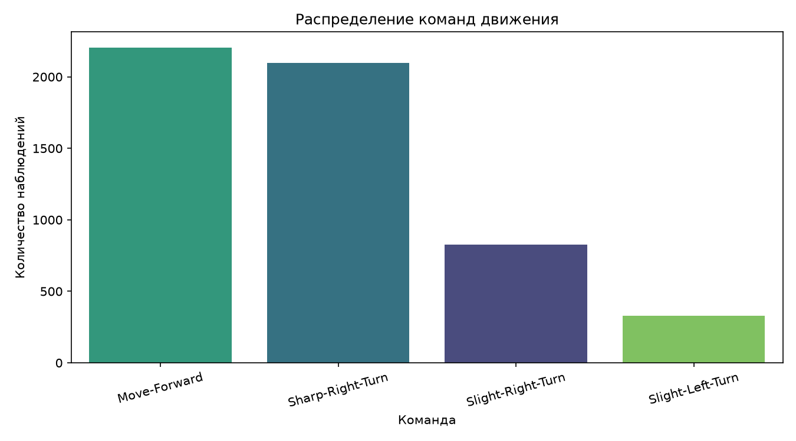
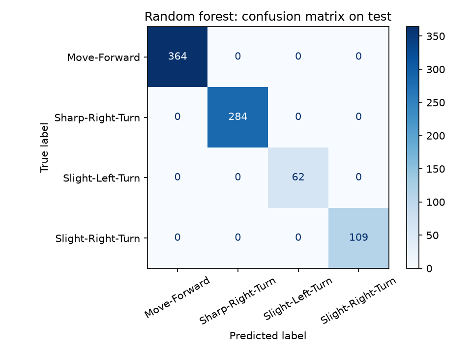
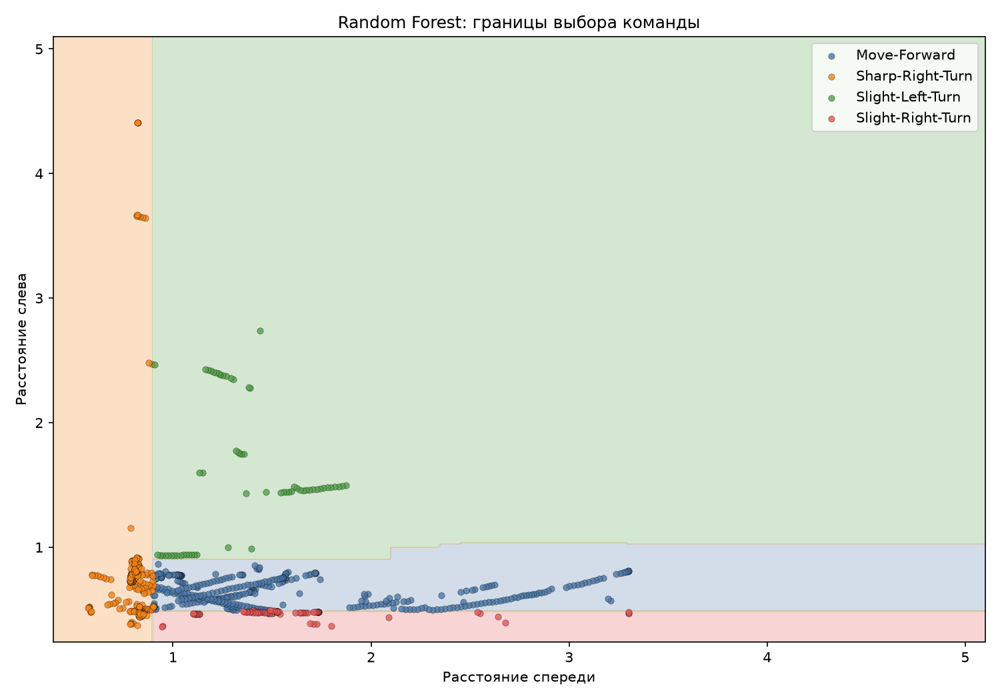
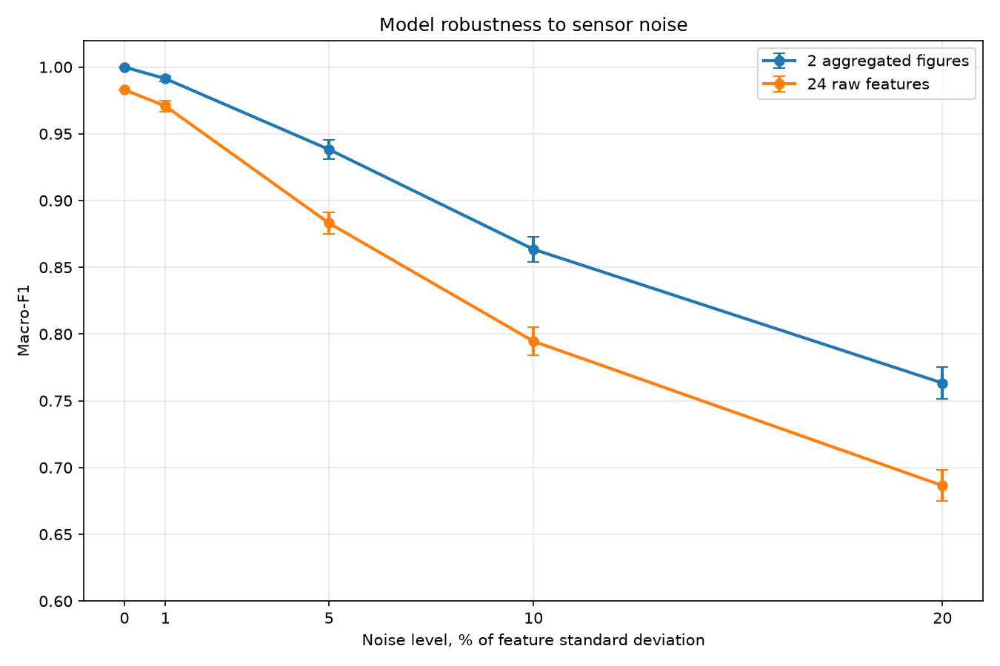

# Классификация команд мобильного робота по данным датчиков

ML-проект для предсказания команды движения мобильного робота по показаниям ультразвуковых датчиков.

В проекте используется датасет UCI Wall-Following Robot Navigation, собранный во время движения робота SCITOS G5 вдоль стены.

## Задача

По показаниям датчиков необходимо предсказать одну из четырех команд:

- `Move-Forward` — движение вперед;
- `Sharp-Right-Turn` — резкий поворот вправо;
- `Slight-Right-Turn` — небольшой поворот вправо;
- `Slight-Left-Turn` — небольшой поворот влево.

Сравниваются три представления данных:

- 24 исходных показания ультразвуковых датчиков;
- 4 агрегированных расстояния: спереди, слева, справа и сзади;
- 2 агрегированных расстояния: спереди и слева.

Агрегированные признаки являются минимальными показаниями нескольких датчиков внутри соответствующих секторов. Поэтому два признака не означают два физических датчика.

## Ключевые результаты

| Эксперимент | Признаки | Accuracy | Macro-F1 |
|---|---:|---:|---:|
| Most Frequent baseline, validation | 24 | 0.3741 | 0.1361 |
| Logistic Regression, validation | 24 | 0.6883 | 0.6914 |
| Logistic Regression, validation | 2 | 0.9597 | 0.9636 |
| Random Forest, validation | 24 | 0.9976 | 0.9954 |
| Random Forest, validation | 2 | 1.0000 | 1.0000 |
| Random Forest, случайная CV | 2 | 1.0000 ± 0.0000 | 1.0000 ± 0.0000 |
| Random Forest, последовательная CV | 2 | 0.9899 ± 0.0202 | 0.9468 ± 0.1064 |
| Random Forest, шум 10% | 2 | 0.8734 ± 0.0086 | 0.8635 ± 0.0096 |
| Random Forest, шум 20% | 2 | 0.7754 ± 0.0110 | 0.7633 ± 0.0120 |

Два агрегированных признака `front` и `left` оказались достаточными
для классификации команд на данном датасете. Однако идеальное качество
на отложенной выборке не означает готовность модели к работе на реальном
роботе: последовательная проверка показала нестабильность между фолдами,
а добавление шума заметно снизило качество.

Проект использует открытый датасет
[UCI Wall-Following Robot Navigation](https://archive.ics.uci.edu/dataset/194/wall+following+robot+navigation).

## Датасет

- 5456 последовательных наблюдений;
- 24 исходных признака;
- 4 класса команд;
- пропуски отсутствуют;
- классы несбалансированы: `Slight-Left-Turn` встречается реже остальных.



Данные разделены с сохранением временного порядка:

- train — 70%;
- validation — 15%;
- test — 15%.

Последовательное разделение уменьшает риск попадания соседних по времени наблюдений одновременно в обучающую и тестовую выборки.

## Модели

В проекте исследованы следующие модели:

- baseline, всегда предсказывающий самый частый класс;
- Logistic Regression;
- Random Forest;
- Random Forest с разной глубиной деревьев и количеством признаков.

Основная метрика — macro-F1, поскольку классы несбалансированы.

## Результаты на validation

| Модель | Признаки | Accuracy | Macro-F1 |
|---|---:|---:|---:|
| Most Frequent Baseline | 24 | 0.3741 | 0.1361 |
| Logistic Regression | 24 | 0.6883 | 0.6914 |
| Logistic Regression | 4 | 0.9572 | 0.9609 |
| Logistic Regression | 2 | 0.9597 | 0.9636 |
| Random Forest | 24 | 0.9976 | 0.9954 |
| Random Forest | 4 | 1.0000 | 1.0000 |
| Random Forest | 2 | 1.0000 | 1.0000 |

После ряда экспериментов в качестве финальной модели выбран Random Forest:

- 2 агрегированных признака;
- 300 деревьев;
- максимальная глубина дерева — 4;
- фиксированный `random_state`.

Более простая модель выбрана потому, что она достигла того же качества, что и конфигурации с большим количеством признаков и более глубокими деревьями.

## Результаты на test

Финальная модель повторно обучена на объединённых train и validation.

| Метрика | Значение |
|---|---:|
| Test accuracy | 1.0000 |
| Test macro-F1 | 1.0000 |

Только 0.98% комбинаций признаков из test ранее встречались в train или validation. Поэтому идеальная тестовая метрика не объясняется дубликатами.



## Граница решений

Два признака позволяют визуализировать выученную моделью стратегию.



Модель восстановила интерпретируемую логику движения:

- резко поворачивать вправо, если препятствие спереди слишком близко;
- немного поворачивать вправо, если робот находится слишком близко к левой стене;
- двигаться вперед, если расстояние слева находится в целевом диапазоне;
- немного поворачивать влево, если робот слишком далеко от стены.

## Устойчивость к шуму

К тестовым признакам добавлялся гауссовский шум. Каждый эксперимент повторялся 20 раз.

| Уровень шума | 2 агрегированных признака | 24 исходных признака |
|---:|---:|---:|
| 0% | 1.0000 | 0.9830 |
| 1% | 0.9913 | 0.9708 |
| 5% | 0.9383 | 0.8831 |
| 10% | 0.8635 | 0.7946 |
| 20% | 0.7633 | 0.6865 |

В таблице приведены средние значения macro-F1.



Модель с двумя признаками оказалась устойчивее в рамках проведенного эксперимента. Однако это предварительный стресс-тест: шум добавлялся после агрегации признаков, а не к исходным показаниям физических датчиков.

## Cross-validation

Случайная стратифицированная cross-validation дала оптимистичные результаты, поскольку не учитывала последовательную природу данных.

| Модель | Случайный CV macro-F1 | Последовательный CV macro-F1 |
|---|---:|---:|
| Logistic Regression, 2 признака | 0.9461 ± 0.0078 | 0.9359 ± 0.0274 |
| Random Forest, 2 признака | 1.0000 ± 0.0000 | 0.9468 ± 0.1064 |
| Random Forest, 24 признака | 0.9908 ± 0.0032 | 0.9108 ± 0.1166 |

В первом последовательном фолде находилось только три обучающих примера класса `Slight-Left-Turn`. Это привело к низкому качеству на редком классе и показало важность временной валидации и достаточного количества примеров каждого манёвра.

## Установка

Рекомендуется Python 3.12.

```bash
git clone https://github.com/USERNAME/sensor-robot-navigation.git
cd sensor-robot-navigation

python3 -m venv .venv
source .venv/bin/activate

python -m pip install --upgrade pip
python -m pip install -r requirements.txt
```

Загрузка датасета:

```bash
python src/download_data.py
```

Проверка данных:

```bash
python src/load_data.py
```

## Запуск экспериментов

Baseline:

```bash
python src/train_baseline.py
```

Logistic Regression:

```bash
python src/train_logistic.py
```

Random Forest:

```bash
python src/train_random_forest.py
python src/tune_random_forest.py
```

Cross-validation:

```bash
python src/cross_validate_models.py
python src/cross_validate_sequential.py
```

Проверка устойчивости к шуму:

```bash
python src/sensor_noise_stress.py
python src/plot_noise_results.py
```

Финальная оценка:

```bash
python src/evaluate_final.py
```

## Использование модели

Обучение и сохранение deployment-модели:

```bash
python src/train_final_model.py


## Структура проекта

```text
sensor-robot-navigation/
├── data/
│   ├── processed/
│   └── raw/
├── reports/
│   └── figures/
├── src/
│   ├── download_data.py
│   ├── load_data.py
│   ├── split_data.py
│   ├── train_baseline.py
│   ├── train_logistic.py
│   ├── train_random_forest.py
│   ├── tune_random_forest.py
│   ├── evaluate_final.py
│   ├── train_final_model.py
│   ├── predict.py
│   ├── sensor_noise_stress.py
│   └── cross_validate_sequential.py
├── models/
│   └── .gitkeep
├── tests/
│   └── test_predict.py
├── pytest.ini
├── requirements.txt
└── README.md
```

## Ограничения

- Модель проверена только на данных из одного помещения.
- Метки отражают поведение исходного контроллера.
- Идеальная классификация не гарантирует безопасное управление реальным роботом.
- Отказы датчиков и реалистичный временной шум не моделировались.
- В датасете отсутствуют идентификаторы четырех отдельных кругов движения.
- Для реального применения необходимы онлайн-тестирование и отдельный контур безопасности.

## Источник данных

Freire, A., Veloso, M., and Barreto, G.  
*Wall-Following Robot Navigation Data*.  
UCI Machine Learning Repository, 2009.

- Датасет: https://archive.ics.uci.edu/dataset/194/wall+following+robot+navigation+data
- DOI: https://doi.org/10.24432/C57C8W
- Лицензия: CC BY 4.0
